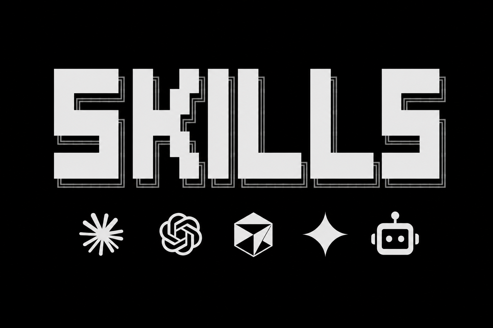

<p align="center">
  
</p>

<h1 align="center">Skills para agentes de IA, en español</h1>

<p align="center">
  <a href="https://x.com/kraayenjon">
    
  </a>
  <a href="https://www.linkedin.com/in/jonathan-kraayenbrink/">
    
  </a>
  <a href="https://skillsagentes.com">
    
  </a>
</p>


Las skills que la gente usa a diario, explicadas en español: qué hace cada una, cuándo te sirve y cómo instalarla en un comando.

Sirven para Claude Code, Codex, Cursor, Gemini CLI, Clawbot, OpenCode y el resto de los agentes.

Esta página es la selección. Si quieres el catálogo entero, está en **[skillsagentes.com](https://skillsagentes.com)**: más de 1.800 skills y servidores MCP indexados uno a uno, con buscador, 18 categorías, ranking de instalaciones y una ficha por skill con lo que consume en tokens, qué permisos pide y cómo instalarla. Al final de cada categoría de aquí abajo tienes el enlace a la categoría equivalente del directorio.

---

## Índice

**Antes de empezar**

- [Por qué existe esto](#por-qué-existe-esto)
- [Qué es una skill](#qué-es-una-skill)
- [Un repo no es una skill](#un-repo-no-es-una-skill)
- [Antes de instalar nada: sentido común](#antes-de-instalar-nada-sentido-común)
- [Cómo instalar](#cómo-instalar)

**Listado de Skills**

- [Por dónde empezar](#por-dónde-empezar)
- [Calidad de código y revisión](#calidad-de-código-y-revisión)
- [Frameworks y stacks](#frameworks-y-stacks)
- [Testing y QA](#testing-y-qa)
- [Seguridad](#seguridad)
- [DevOps e infraestructura](#devops-e-infraestructura)
- [Bases de datos y backend](#bases-de-datos-y-backend)
- [Datos y analítica](#datos-y-analítica)
- [Diseño y UI](#diseño-y-ui)
- [Ahorro de tokens](#ahorro-de-tokens)
- [Memoria y contexto](#memoria-y-contexto)
- [Entender un codebase](#entender-un-codebase)
- [Marketing y ventas](#marketing-y-ventas)
- [SEO, GEO y redacción](#seo-geo-y-redacción)
- [Investigación](#investigación)
- [Documentos y presentaciones](#documentos-y-presentaciones)
- [Navegador y automatización](#navegador-y-automatización)
- [Vídeo y multimedia](#vídeo-y-multimedia)
- [Productividad y control](#productividad-y-control)
- [Listas y recursos para seguir](#listas-y-recursos-para-seguir)

---

## Por qué existe esto

Casi todo lo que se publica sobre skills está en inglés: en X, en newsletters y en repos que circulan entre developers angloparlantes. Si no consumes ese contenido a diario, te enteras tarde o directamente no te enteras.

No es un problema de nivel técnico. Es un problema de canal.

Este repo es el índice que a esa gente le falta — qué existe, qué hace cada cosa y cómo se instala, en una sola página. Cuando esta página se te quede corta, [skillsagentes.com](https://skillsagentes.com) es la versión larga: el directorio completo, en español, con buscador y ficha por skill.

---

## Qué es una skill

Una skill es una carpeta con un archivo `SKILL.md` dentro. Ese archivo le explica al agente cómo hacer una tarea concreta: revisar código, respetar un sistema de diseño, generar un PDF, escribir un test.

En esa carpeta cabe mucho más que el `SKILL.md`. Una skill también puede llevar:

- **Ejemplos de referencia** — cinco posts tuyos para que copie tu tono, tres componentes bien hechos para que imite el patrón. Enseñar con ejemplos funciona mejor que describir con adjetivos.
- **Documentación de apoyo** — archivos aparte con la parte densa: tu guía de marca, la tabla de tokens de diseño, la lista de endpoints. El `SKILL.md` los menciona y el agente los abre solo si los necesita.
- **Scripts que se ejecutan** — Python, bash, lo que sea. Si el paso es determinista (redimensionar imágenes, validar un JSON, consultar una base), no tiene sentido que el agente lo improvise: mejor que corra el script.
- **Plantillas y assets** — un `.docx` con tus estilos, un HTML base, un esquema de configuración.
- **Herramientas externas** — la skill puede decirle al agente qué MCP usar, qué CLI llamar o a qué API pegarle, y en qué orden.

Por eso una skill buena se parece más a un manual de onboarding con anexos que a un prompt largo.

El agente lee solo el título y la descripción al arrancar. Carga el `SKILL.md` cuando la tarea lo pide, y el resto de archivos solo si hacen falta. Por eso puedes tener 40 skills instaladas sin que te coman el contexto.

No es un prompt que pegas cada vez. Se instala una vez y queda.

**No confundir con MCP:** un MCP conecta al agente con una herramienta externa (una base de datos, Slack, tu Stripe). Una skill le explica el procedimiento. Son capas distintas y se usan juntas.

---

## Un repo no es una skill

Esta es la parte que confunde a casi todo el mundo, y no la explica nadie.

La mayoría de los repos de esta lista son **packs**: traen varias skills dentro. `mattpocock/skills` no es una skill, son más de 30. `grill-me` y `tdd` son dos de ellas.

Eso cambia cómo instalas:

```bash
npx skills add mattpocock/skills                    # instala el pack entero
npx skills add mattpocock/skills --skill grill-me   # instala solo una
```

Instalar el pack completo cuando querías una sola skill es la forma más rápida de llenar tu agente de cosas que no vas a usar. En la tabla marco con **(pack)** los repos que traen varias, y cuando el pack es enorme te digo qué skill concreta es la que te interesa para esa categoría.

---

## Antes de instalar nada: sentido común

Una skill no es una librería aislada. Es un archivo de texto que tu agente va a leer y ejecutar **con tus permisos, en tu máquina, sobre tu código**. Trátalo como tratarías a alguien que te pide la llave de tu casa.

Nada de esto es paranoia. Es lo mismo que harías antes de instalar cualquier dependencia.

**Mira el repo, no solo el número**

- Las estrellas miden atención, no calidad. Un repo puede tener 90k estrellas de un hilo viral y no servirte para nada si trabajas en otro stack.
- Mira la **fecha del último commit**. En este ecosistema, tres meses sin tocar es mucho.
- Mira **issues y PRs abiertos**. Si hay gente reportando que rompe cosas y nadie contesta, ya sabes.
- Mira **quién lo mantiene**. Un autor con nombre, historial y otros repos vale más que una cuenta creada el mes pasado.
- Desconfía del repo que apareció hace dos semanas con 50k estrellas y ningún issue. Ese patrón existe.

**Lee el SKILL.md antes de instalarlo**

Es la ventaja de este formato: son 100 líneas de markdown, no 10.000 de código compilado. Puedes leerlo entero en dos minutos.

Busca específicamente si la skill ejecuta comandos, hace peticiones a dominios externos, pide claves API o toca archivos fuera del proyecto.

**Pídele a tu propio agente que lo revise**

Es lo más rápido y casi nadie lo hace:

```
Lee este SKILL.md antes de que lo instale. Dime si ejecuta comandos de shell,
si hace peticiones a dominios externos, si pide credenciales o si modifica
archivos fuera del proyecto. Si algo te parece raro, dímelo sin suavizarlo.
```

**Pruébala antes de que se quede**

```bash
npx skills use owner/repo@nombre --agent claude-code
```

Eso la ejecuta sin instalarla. Si te sirve, la instalas.

**Y luego, lo obvio**

- Instala **de a una**. Si metes 20 de golpe y algo empieza a fallar, no vas a saber cuál fue.
- Pruébalas primero en un proyecto de test, no en el que te da de comer.
- Instala en el proyecto (`npx skills add`) antes que en global (`-g`). Global significa en todos tus proyectos, siempre.
- Si una skill no la usaste en dos semanas, desinstálala. Ocupan contexto y ruido mental.

---

## Cómo instalar

### Opción 1 — `npx skills`

Funciona con cualquier agente, no solo Claude Code.

```bash
npx skills add owner/repo                  # en el proyecto actual
npx skills add owner/repo -g               # global, para todos tus proyectos
npx skills add owner/repo --skill nombre   # solo una skill del pack
```

Probar una sin instalarla:

```bash
npx skills use owner/repo@nombre --agent claude-code
```

### Opción 2 — plugins de Claude Code

Desde dentro de Claude Code:

```
/plugin marketplace add anthropics/skills
/plugin install document-skills@anthropic-agent-skills
```

### Opción 3 — a mano

Copia la carpeta de la skill en `~/.claude/skills/` para tenerla en todos los proyectos, o en `.claude/skills/` dentro de un proyecto concreto.

---


## Por dónde empezar

Si nunca instalaste una skill, las cuatro primeras son el camino corto. El resto de la tabla es lo que instala casi todo el mundo después.


| Skill                                                                                       | Qué hace                                                                                                                    | ★    |
| ------------------------------------------------------------------------------------------- | ----------------------------------------------------------------------------------------------------------------------------- | ---- |
| [vercel-labs/skills](https://github.com/vercel-labs/skills)                                 | La herramienta con la que instalas todo lo demás. `npx skills`. Funciona en Claude Code, Codex, Cursor y otros                | 29k  |
| [anthropics/skills](https://github.com/anthropics/skills) **(pack)**                        | Las oficiales de Anthropic. Documentos Office, PDF, diseño frontend. Lo más seguro para arrancar                              | 168k |
| [obra/superpowers](https://github.com/obra/superpowers) **(pack)**                          | El framework de skills más adoptado. No es una skill suelta: es una metodología completa de desarrollo con agentes            | 271k |
| [anthropics/claude-plugins-official](https://github.com/anthropics/claude-plugins-official) | El directorio oficial de plugins mantenido por Anthropic. Si dudas de la procedencia de algo, empieza acá                     | 33k  |
| [anthropics/claude-code](https://github.com/anthropics/claude-code) **(pack)**              | Las skills oficiales para construir tus propias cosas: crear skills, subagentes, comandos, hooks, plugins e integraciones MCP | 141k |
| [mattpocock/skills](https://github.com/mattpocock/skills) **(pack)**                        | El directorio real de Matt Pocock, abierto. Ingeniería, escritura y proceso                                                   | 214k |
| [garrytan/gstack](https://github.com/garrytan/gstack) **(pack)**                            | La suite de Garry Tan: 59 skills con un router que decide cuál usar. Planificar, revisar, diseñar, desplegar                  | 129k |
| [multica-ai/andrej-karpathy-skills](https://github.com/multica-ai/andrej-karpathy-skills)    | Un único `CLAUDE.md` para mejorar el comportamiento del agente, derivado de las observaciones de Andrej Karpathy              | 201k |
| [addyosmani/agent-skills](https://github.com/addyosmani/agent-skills) **(pack)**             | Skills de ingeniería de producción, de Addy Osmani (Google Chrome)                                                            | 89k  |
| [wshobson/agents](https://github.com/wshobson/agents) **(pack)**                             | El pack más grande de todos: 180 skills. Los mismos plugins para Claude Code, Codex CLI, Cursor, OpenCode y GitHub Copilot    | 39k  |


Cuando quieras ver el mapa completo, el directorio tiene [todas las categorías de skills](https://skillsagentes.com/categorias) ordenadas por caso de uso.

---

## Calidad de código y revisión


| Skill                                                                                                      | Qué hace                                                                                                                                                               | ★    |
| ---------------------------------------------------------------------------------------------------------- | ---------------------------------------------------------------------------------------------------------------------------------------------------------------------- | ---- |
| [mattpocock/skills](https://github.com/mattpocock/skills) **(pack)**                                       | Más de 30 skills de ingeniería sacadas del directorio real de Matt Pocock. `grill-me` te interroga el plan antes de escribir código, `tdd` te fuerza el ciclo de tests | 214k |
| [addyosmani/agent-skills](https://github.com/addyosmani/agent-skills) **(pack)**                           | Skills de ingeniería de producción, de Addy Osmani (Google Chrome). `code-simplification` y `code-review-and-quality` son las que más se usan                          | 89k  |
| [wshobson/agents](https://github.com/wshobson/agents) **(pack)**                                           | Marketplace multi-agente: los mismos plugins para Claude Code, Codex CLI, Cursor, OpenCode y GitHub Copilot                                                            | 39k  |
| [EveryInc/compound-engineering-plugin](https://github.com/EveryInc/compound-engineering-plugin) **(pack)** | Plugin de compound engineering: que cada tarea deje el proyecto mejor preparado para la siguiente                                                                      | 24k  |
| [affaan-m/ECC](https://github.com/affaan-m/ECC) **(pack)**                                                 | Sistema completo de optimización del agente: skills, memoria, seguridad y límites                                                                                      | 238k |
| [garrytan/gstack](https://github.com/garrytan/gstack) **(pack)**                                           | `autoplan` planifica antes de tocar nada y `careful` frena al agente en los cambios peligrosos. El resto de la suite se engancha alrededor                             | 129k |
| [anthropics/claude-code](https://github.com/anthropics/claude-code) **(pack)**                             | Cómo escribir skills, comandos, hooks y plugins que no se rompan. Si vas a crear las tuyas, empieza por `skill-development`                                            | 141k |
| [herdrdev/herdr](https://github.com/herdrdev/herdr) **(pack)**                                             | Triage de issues abiertos en una tabla de decisiones, mensajes de commit decentes y auditoría antes de publicar una release                                            | 30k  |
| [addyosmani/web-quality-skills](https://github.com/addyosmani/web-quality-skills) **(pack)**               | Auditoría de calidad web en un comando: rendimiento, accesibilidad, SEO y buenas prácticas, al estilo Lighthouse                                                       | 2.6k |
| [dmmulroy/anti-slop](https://github.com/dmmulroy/anti-slop)                                                | Instala reglas de lint (Oxlint) que cazan los patrones típicos del código generado por IA antes de que lleguen al PR                                                   | 3.3k |


Son 340 en total: las tienes todas en [skills para desarrolladores](https://skillsagentes.com/categorias/herramientas-desarrollo).

---

## Frameworks y stacks

Skills oficiales, mantenidas por la gente que hace el framework. Son las que evitan que el agente escriba la API de hace dos versiones.


| Skill                                                                                             | Qué hace                                                                                                             | ★    |
| ------------------------------------------------------------------------------------------------- | -------------------------------------------------------------------------------------------------------------------- | ---- |
| [shadcn-ui/ui](https://github.com/shadcn-ui/ui) **(pack)**                                        | La oficial de shadcn: añadir, buscar, depurar y componer componentes, más la migración de Radix a Base UI            | 121k |
| [greensock/gsap-skills](https://github.com/greensock/gsap-skills) **(pack)**                      | Las oficiales de GSAP: core, timelines, ScrollTrigger, plugins, React y rendimiento                                  | 14k  |
| [antfu/skills](https://github.com/antfu/skills) **(pack)**                                        | Las de Anthony Fu (Vue, Vite, Nuxt). Vue, Vite, Vitest, UnoCSS, Pinia, Nitro, VitePress y Slidev                     | 5.8k |
| [vuejs-ai/skills](https://github.com/vuejs-ai/skills) **(pack)**                                  | Las oficiales de Vue: Composition API, Pinia, Router, JSX, testing y guías de depuración                             | 2.8k |
| [expo/skills](https://github.com/expo/skills) **(pack)**                                          | Las oficiales de Expo: Expo Router, Expo UI, módulos nativos, EAS Build y migraciones de versión                     | 2.4k |
| [vercel/ai](https://github.com/vercel/ai) **(pack)**                                              | Las del AI SDK de Vercel: migrar de v6 a v7, añadir providers, escribir ejemplos y fixtures de test                  | 26k  |
| [mcollina/skills](https://github.com/mcollina/skills) **(pack)**                                  | Las de Matteo Collina (Node.js core, Fastify): Node moderno, TypeScript, Fastify, linting y OAuth                    | 1.9k |
| [samber/cc-skills-golang](https://github.com/samber/cc-skills-golang) **(pack)**                  | 46 skills de Go: Cobra, Viper, GraphQL, Swagger, concurrencia segura y librerías `samber/*`                          | 3.0k |
| [firebase/agent-skills](https://github.com/firebase/agent-skills) **(pack)**                      | Las oficiales de Firebase: Auth, Firestore, reglas de seguridad, Functions y App Hosting                             | 406  |
| [solana-foundation/solana-dev-skill](https://github.com/solana-foundation/solana-dev-skill)       | La oficial de Solana: programas Anchor, tokens, wallets, tests, fuzzing y despliegue a devnet                        | 548  |


El directorio agrupa estas y el resto en [más skills de desarrollo](https://skillsagentes.com/categorias/herramientas-desarrollo).

---

## Testing y QA


| Skill                                                                                                                                | Qué hace                                                                                                                | ★    |
| ------------------------------------------------------------------------------------------------------------------------------------ | ------------------------------------------------------------------------------------------------------------------------ | ---- |
| [obra/superpowers](https://github.com/obra/superpowers) **(pack)**                                                                   | El ciclo de TDD y verificación del framework más adoptado. `requesting-code-review` es la que más se instala suelta      | 271k |
| [browser-use/browser-use](https://github.com/browser-use/browser-use) **(pack)**                                                      | Control directo del navegador por CDP. La skill `qa` recorre la app y reporta lo que se rompe                            | 109k |
| [anthropics/skills](https://github.com/anthropics/skills) **(pack)**                                                                 | `webapp-testing`: la oficial de Anthropic para probar una app web de punta a punta                                       | 168k |
| [Donchitos/Claude-Code-Game-Studios](https://github.com/Donchitos/Claude-Code-Game-Studios) **(pack)**                                | 17 skills de QA organizadas como un equipo real: plan de pruebas, casos, reporte de bugs y ciclo de regresión            | 24k  |
| [microsoft/playwright-cli](https://github.com/microsoft/playwright-cli) **(pack)**                                                    | La oficial de Microsoft: automatiza el navegador y escribe, corre y depura tests de Playwright                           | 12k  |
| [wshobson/agents](https://github.com/wshobson/agents) **(pack)**                                                                     | 19 skills de testing dentro del pack: unitarios, integración, carga, contract testing y Web3                             | 39k  |
| [google/agents-cli](https://github.com/google/agents-cli) **(pack)**                                                                 | El CLI de agentes de Google (ADK): `eval` para evaluar un agente y `observability` para ver por qué falla                | 5.6k |
| [currents-dev/playwright-best-practices-skill](https://github.com/currents-dev/playwright-best-practices-skill)                       | Buenas prácticas de Playwright: tests flaky, Page Object Model, mocks de API, autenticación y CI                         | 354  |
| [momentic-ai/skills](https://github.com/momentic-ai/skills) **(pack)**                                                                | E2E en móvil (Android e iOS) con validación en dispositivo real vía MCP                                                  | 13   |
| [liarjsdev/liarjs-skills](https://github.com/liarjsdev/liarjs-skills) **(pack)**                                                      | Audita la huella del navegador (canvas, WebGL, fuentes, WebRTC) y falla el build si tu browser automatizado se delata     | 2    |


Hay 110 más en [skills de testing y QA](https://skillsagentes.com/categorias/testing-qa).

---

## Seguridad

La categoría que menos se instala y más se echa de menos.


| Skill                                                                                       | Qué hace                                                                                                              | ★    |
| ------------------------------------------------------------------------------------------- | ----------------------------------------------------------------------------------------------------------------------- | ---- |
| [garrytan/gstack](https://github.com/garrytan/gstack) **(pack)**                            | `careful`: frena al agente antes de un comando destructivo y le obliga a explicar qué va a tocar                       | 129k |
| [addyosmani/agent-skills](https://github.com/addyosmani/agent-skills) **(pack)**             | `security-and-hardening`: repasa la superficie de ataque de una app web y propone el endurecimiento                    | 89k  |
| [wshobson/agents](https://github.com/wshobson/agents) **(pack)**                             | 19 skills de seguridad: auditoría OWASP, gestión de secretos, threat modeling y seguridad en Solidity                  | 39k  |
| [googleworkspace/cli](https://github.com/googleworkspace/cli) **(pack)**                     | Model Armor: plantillas de filtrado para lo que entra y sale de un modelo dentro de Google Workspace                   | 30k  |
| [microsoft/azure-skills](https://github.com/microsoft/azure-skills) **(pack)**               | Cumplimiento, identidad y postura de seguridad en Azure, más el AI Gateway                                             | 1.4k |
| [cloudflare/skills](https://github.com/cloudflare/skills) **(pack)**                         | Cloudflare One / Zero Trust: Access, Gateway, WARP, Tunnel, DLP, CASB y Turnstile                                      | 2.6k |
| [better-auth/skills](https://github.com/better-auth/skills) **(pack)**                       | Autenticación bien hecha en TypeScript: email y contraseña, 2FA, organizaciones, OAuth y buenas prácticas              | 206  |
| [firebase/agent-skills](https://github.com/firebase/agent-skills) **(pack)**                 | Firebase Auth y reglas de seguridad de Firestore, que es donde se filtran los datos de medio internet                  | 406  |
| [samber/cc-skills-golang](https://github.com/samber/cc-skills-golang) **(pack)**             | `golang-safety` y `golang-security`: los errores de concurrencia y de manejo de datos típicos de Go                    | 3.0k |
| [useosint/osint-skills](https://github.com/useosint/osint-skills) **(pack)**                 | OSINT defensivo: qué se ha filtrado de ti, qué servidores tuyos están expuestos, qué subdominios tienes olvidados      | 13   |
| [morluto/rea](https://github.com/morluto/rea) | `reverse-engineer-anything`: guía al agente para analizar binarios y apps JavaScript/Electron con CLI/MCP local y evidencias; el análisis nativo avanzado requiere Hopper, Ghidra o IDA | 38.1k |


El directorio tiene 55 en total en [skills de seguridad](https://skillsagentes.com/categorias/seguridad).

---

## DevOps e infraestructura


| Skill                                                                                       | Qué hace                                                                                                            | ★    |
| ------------------------------------------------------------------------------------------- | --------------------------------------------------------------------------------------------------------------------- | ---- |
| [vercel/turborepo](https://github.com/vercel/turborepo)                                     | La oficial de Turborepo: pipelines de tareas, caché remota, `--filter`, `--affected` y estructura de monorepo        | 31k  |
| [vercel-labs/agent-skills](https://github.com/vercel-labs/agent-skills) **(pack)**           | `deploy-to-vercel` y las guías de despliegue y entornos de Vercel                                                    | 30k  |
| [wshobson/agents](https://github.com/wshobson/agents) **(pack)**                             | 31 skills de infraestructura: Kubernetes, Terraform, CI/CD, observabilidad y caché de Turborepo                      | 39k  |
| [addyosmani/agent-skills](https://github.com/addyosmani/agent-skills) **(pack)**             | `deprecation-and-migration`: cómo migrar sin romper a los que ya dependen de ti                                      | 89k  |
| [garrytan/gstack](https://github.com/garrytan/gstack) **(pack)**                             | Actualización de dependencias, entornos y el gate de "mide antes de arreglar"                                        | 129k |
| [microsoft/azure-skills](https://github.com/microsoft/azure-skills) **(pack)**               | 29 skills de Azure: despliegue, AKS, App Insights, planificación de infra empresarial y control de coste             | 1.4k |
| [cloudflare/skills](https://github.com/cloudflare/skills) **(pack)**                         | Workers, Durable Objects, Wrangler, sandboxes y el SDK de agentes de Cloudflare                                      | 2.6k |
| [expo/skills](https://github.com/expo/skills) **(pack)**                                     | EAS: builds, workflows, hosting y observabilidad para apps React Native                                              | 2.4k |
| [get-convex/agent-skills](https://github.com/get-convex/agent-skills) **(pack)**             | 33 skills de Convex: crons, backups, `launch-readiness`, control de coste y auditoría de permisos                    | 43   |
| [firebase/agent-skills](https://github.com/firebase/agent-skills) **(pack)**                 | App Hosting, Cloud Functions y despliegue de proyectos Firebase                                                      | 406  |


Son 123 en total en [skills de DevOps e infraestructura](https://skillsagentes.com/categorias/devops-infraestructura).

---

## Bases de datos y backend


| Skill                                                                                       | Qué hace                                                                                                                | ★    |
| ------------------------------------------------------------------------------------------- | ------------------------------------------------------------------------------------------------------------------------- | ---- |
| [supabase/agent-skills](https://github.com/supabase/agent-skills) **(pack)**                 | Buenas prácticas de Postgres mantenidas por Supabase, válidas para cualquier Postgres. Cárgala antes de tocar el esquema | 2.5k |
| [prisma/skills](https://github.com/prisma/skills) **(pack)**                                 | El ORM Prisma de punta a punta: Client API, CLI, adaptadores, migraciones y el salto a la v7                             | 53   |
| [neondatabase/agent-skills](https://github.com/neondatabase/agent-skills) **(pack)**         | Postgres serverless en Neon: branches de base de datos, funciones, object storage y optimización de egress               | 82   |
| [get-convex/agent-skills](https://github.com/get-convex/agent-skills) **(pack)**             | Diseño de esquema, autorización y optimización de queries en Convex                                                      | 43   |
| [stripe/ai](https://github.com/stripe/ai) **(pack)**                                         | Las oficiales de Stripe: buenas prácticas de cobros, Connect, Stripe Apps y aprovisionar servicios desde el CLI          | 1.7k |
| [wshobson/agents](https://github.com/wshobson/agents) **(pack)**                             | `sql-optimization-patterns` y 12 skills más de diseño de APIs, integraciones de pago y arquitectura backend              | 39k  |
| [anthropics/claude-code](https://github.com/anthropics/claude-code) **(pack)**               | `mcp-integration`: cómo conectar el agente a un servidor MCP sin inventarse el protocolo                                 | 141k |
| [firecrawl/skills](https://github.com/firecrawl/skills) **(pack)**                           | Integrar la API de Firecrawl en tu propio backend: scrape, search, interact y onboarding                                 | 78   |
| [intellectronica/agent-skills](https://github.com/intellectronica/agent-skills) **(pack)**   | Piezas sueltas de backend: Upstash Redis KV, SDK de Copilot, APIs de terceros                                            | 281  |
| [garrytan/gbrain](https://github.com/garrytan/gbrain) **(pack)**                             | `schema-unify` y las skills de ingesta: unificar esquemas dispares y meterlos en una base consultable                    | 29k  |


El directorio las separa en [skills para bases de datos](https://skillsagentes.com/categorias/bases-de-datos) y [skills de desarrollo de APIs](https://skillsagentes.com/categorias/desarrollo-apis).

---

## Datos y analítica


| Skill                                                                                                             | Qué hace                                                                                                                | ★    |
| ----------------------------------------------------------------------------------------------------------------- | ------------------------------------------------------------------------------------------------------------------------- | ---- |
| [Graphify-Labs/graphify](https://github.com/Graphify-Labs/graphify)                                                | Convierte un codebase entero — con sus docs, esquemas SQL, configs y PDFs — en un grafo de conocimiento consultable      | 109k |
| [wshobson/agents](https://github.com/wshobson/agents) **(pack)**                                                   | 12 skills de datos: pipelines, búsqueda híbrida, embeddings y arquitectura analítica                                     | 39k  |
| [garrytan/gbrain](https://github.com/garrytan/gbrain) **(pack)**                                                   | Ingesta de fuentes, grafo de citas y reports con timestamp que luego consultas por keyword                               | 29k  |
| [larksuite/cli](https://github.com/larksuite/cli) **(pack)**                                                       | Lark Base y Lark Sheets desde el agente: leer, escribir y automatizar hojas y bases                                      | 16k  |
| [browser-act/skills](https://github.com/browser-act/skills) **(pack)**                                             | 68 skills de extracción vía API: Google Maps, LinkedIn, YouTube, e-commerce, directorios locales                         | 5.4k |
| [microsoft/azure-skills](https://github.com/microsoft/azure-skills) **(pack)**                                     | Consultas Kusto y grafo de recursos de Azure para responder preguntas sobre tu propia infraestructura                    | 1.4k |
| [firecrawl/cli](https://github.com/firecrawl/cli) **(pack)**                                                       | Scrape, crawl, map y monitorización de cambios en webs, sin montar scrapers ni cron jobs                                 | 583  |
| [nexscope-ai/Amazon-Skills](https://github.com/nexscope-ai/Amazon-Skills) **(pack)**                               | 52 skills de Amazon: research de producto, seguimiento de keywords, márgenes FBA y análisis de competencia               | 529  |
| [Wind-Information-Co-Ltd/wind-skills](https://github.com/Wind-Information-Co-Ltd/wind-skills) **(pack)**           | 78 skills de mercados financieros: escaneos, momentum, flujos de capital y comparables. En chino                         | 79   |
| [ScrapeGraphAI/just-scrape](https://github.com/ScrapeGraphAI/just-scrape)                                          | Buscar, scrapear y extraer JSON estructurado de cualquier web desde el CLI de ScrapeGraph                                | 46   |


Hay 159 en total en [skills de datos y analítica](https://skillsagentes.com/categorias/datos-analitica).

---

## Diseño y UI

Esta categoría es la que más rápido se nota. Es la diferencia entre una app que parece vibe-codeada y una que no.


| Skill                                                                                           | Qué hace                                                                                                                                                                             | ★    |
| ----------------------------------------------------------------------------------------------- | ------------------------------------------------------------------------------------------------------------------------------------------------------------------------------------ | ---- |
| [nextlevelbuilder/ui-ux-pro-max-skill](https://github.com/nextlevelbuilder/ui-ux-pro-max-skill) | Criterio de diseño UI/UX para varias plataformas. La más instalada de la categoría                                                                                                   | 116k |
| [Leonxlnx/taste-skill](https://github.com/Leonxlnx/taste-skill) **(pack)**                      | Le da buen gusto al agente. Evita el diseño genérico de siempre: los mismos violetas, los mismos botones                                                                             | 76k  |
| [pbakaus/impeccable](https://github.com/pbakaus/impeccable)                                     | Un lenguaje de diseño que el agente sigue de forma consistente en todo el proyecto                                                                                                   | 59k  |
| [emilkowalski/skills](https://github.com/emilkowalski/skills) **(pack)**                        | Las skills de Emil Kowalski, el referente de animación e interfaz en la web. Detalle fino: transiciones, microinteracciones, lo que separa una UI correcta de una que se siente bien | 29k  |
| [anthropics/skills](https://github.com/anthropics/skills) **(pack)**                            | `frontend-design`: la de Anthropic para que lo que genera no parezca una demo                                                                                                        | 168k |
| [Nutlope/hallmark](https://github.com/Nutlope/hallmark)                                         | Anti-slop de diseño: páginas nuevas, rediseños, auditorías y extraer el sistema de diseño de una URL o una captura                                                                   | 26k  |
| [oso95/scroll-world](https://github.com/oso95/scroll-world)                                     | Landing con scroll cinematográfico: la cámara vuela por escenas pre-renderizadas sin cortes mientras el visitante baja                                                               | 8.4k |
| [google-labs-code/stitch-skills](https://github.com/google-labs-code/stitch-skills) **(pack)**  | Stitch, de Google Labs: genera el diseño, gestiona el design system y lo pasa a React, React Native o HTML                                                                           | 8.0k |
| [jakubkrehel/make-interfaces-feel-better](https://github.com/jakubkrehel/make-interfaces-feel-better) | Principios de design engineering: sombras, bordes, tipografía, hover, animaciones de entrada y salida                                                                          | 2.9k |
| [oil-oil/oil-motion](https://github.com/oil-oil/oil-motion)                                     | Animación web interactiva: scroll, puntero, drag, touch, orientación del dispositivo, audio y estado de componente                                                                   | 2.0k |
| [kraayenjon/claude-pagekit](https://github.com/kraayenjon/claude-pagekit) **(pack)**            | Mía. 16 skills que hacen una web entera desde una conversación: diseño que no parece de IA, textos de conversión, `llms.txt` y datos estructurados para que te citen, y deploy. Español o inglés | —    |


Son 239 en total: las tienes en [skills de diseño y UI](https://skillsagentes.com/categorias/diseno-ui).

---

## Ahorro de tokens

Categoría corta a propósito. Casi todo lo que promete ahorrar tokens es humo; esto es lo que de verdad cambia la factura.


| Skill                                                                 | Qué hace                                                                                                                | ★    |
| --------------------------------------------------------------------- | ------------------------------------------------------------------------------------------------------------------------- | ---- |
| [JuliusBrussee/caveman](https://github.com/JuliusBrussee/caveman) **(pack)** | Recorta un 65% de los tokens haciendo que el agente responda sin relleno ni cortesías, manteniendo la precisión técnica | 97k  |
| [DietrichGebert/ponytail](https://github.com/DietrichGebert/ponytail) **(pack)** | Hace que el agente piense como el senior más vago del equipo: el mejor código es el que no escribes                 | 101k |
| [NanoNets/Graft](https://github.com/NanoNets/Graft)                   | Indexa el repo para que el agente encuentre dónde vive el código sin leerse archivos enteros                             | 4.2k |
| [ayghri/i-have-adhd](https://github.com/ayghri/i-have-adhd)           | Formatea la salida para leerla de un vistazo: primero la acción, pasos numerados, sin tangentes                          | 23k  |
| [Leonxlnx/taste-skill](https://github.com/Leonxlnx/taste-skill) **(pack)** | `full-output-enforcement`: evita que el agente te devuelva el archivo a medias y te obligue a pedirlo otra vez        | 76k  |


El directorio te deja filtrar por peso: mira las [skills ligeras en tokens](https://skillsagentes.com/skills?sort=light), ordenadas de menos a más contexto consumido.

---

## Memoria y contexto

El problema más caro de trabajar con agentes: cada sesión arranca de cero.


| Skill                                                                                                                                    | Qué hace                                                                                                        | ★    |
| ---------------------------------------------------------------------------------------------------------------------------------------- | ----------------------------------------------------------------------------------------------------------------- | ---- |
| [thedotmack/claude-mem](https://github.com/thedotmack/claude-mem)                                                                        | Memoria persistente entre sesiones. Captura lo que hace el agente y se lo devuelve la próxima vez               | 90k  |
| [upstash/context7](https://github.com/upstash/context7)                                                                                  | Documentación actualizada de librerías inyectada en el contexto. Se acabó el código con la API de hace dos años | 60k  |
| [gastownhall/beads](https://github.com/gastownhall/beads)                                                                                | Upgrade de memoria para el agente                                                                               | 26k  |
| [OthmanAdi/planning-with-files](https://github.com/OthmanAdi/planning-with-files) **(pack)**                                             | Planificación en archivos para tareas largas. Si la sesión se cae, el plan sobrevive. Tiene versión en español  | 26k  |
| [muratcankoylan/Agent-Skills-for-Context-Engineering](https://github.com/muratcankoylan/Agent-Skills-for-Context-Engineering) **(pack)** | Colección de skills de context engineering y arquitecturas multi-agente                                         | 18k  |
| [garrytan/gbrain](https://github.com/garrytan/gbrain) **(pack)**                                                                        | 75 skills de "segundo cerebro": ingesta de reuniones, reports con timestamp, consulta por keyword y fact-check  | 29k  |
| [garrytan/gstack](https://github.com/garrytan/gstack) **(pack)**                                                                        | `context-save` y `context-restore`: guarda el estado de la sesión y recupéralo tal cual en la siguiente         | 129k |
| [kepano/obsidian-skills](https://github.com/kepano/obsidian-skills) **(pack)**                                                           | Usa tu bóveda de Obsidian como memoria del agente. De Steph Ango, CEO de Obsidian                               | 45k  |
| [zhaono1/agent-playbook](https://github.com/zhaono1/agent-playbook) **(pack)**                                                           | `session-logger` y `long-task-coordinator`: deja rastro de la sesión y coordina tareas que duran días           | 72   |
| [intellectronica/agent-skills](https://github.com/intellectronica/agent-skills) **(pack)**                                               | Notas, marcadores de Raindrop y `promptify` para convertir contexto suelto en instrucciones reutilizables       | 281  |


El resto está en [skills de productividad](https://skillsagentes.com/categorias/productividad), 212 en total.

---

## Entender un codebase


| Skill                                                                                                       | Qué hace                                                                                                            | ★    |
| ----------------------------------------------------------------------------------------------------------- | --------------------------------------------------------------------------------------------------------------------- | ---- |
| [Graphify-Labs/graphify](https://github.com/Graphify-Labs/graphify)                                          | Convierte un codebase entero — con sus docs, esquemas SQL, configs y PDFs — en un grafo de conocimiento consultable | 109k |
| [yamadashy/repomix](https://github.com/yamadashy/repomix)                                                    | Empaqueta todo un repositorio en un solo archivo listo para pasarle a una IA                                        | 28k  |
| [JCodesMore/ai-website-cloner-template](https://github.com/JCodesMore/ai-website-cloner-template)            | Ingeniería inversa de una web entera: extrae assets, CSS y contenido sección a sección y lanza agentes en paralelo  | 33k  |
| [NanoNets/Graft](https://github.com/NanoNets/Graft)                                                          | Índice del repo para trazar qué llama a qué y qué rompe un cambio, antes de tocar nada                              | 4.2k |
| [garrytan/gstack](https://github.com/garrytan/gstack) **(pack)**                                             | `browse` y `explore`: recorrido guiado del repo antes de planificar                                                 | 129k |
| [mattpocock/skills](https://github.com/mattpocock/skills) **(pack)**                                         | `research`: investiga cómo funciona algo en el propio codebase antes de proponer el cambio                          | 214k |
| [anthropics/claude-code](https://github.com/anthropics/claude-code) **(pack)**                               | `plugin-structure`: entender y navegar la estructura de plugins y skills de un repo ajeno                           | 141k |
| [herdrdev/herdr](https://github.com/herdrdev/herdr) **(pack)**                                               | `triage`: convierte los issues abiertos en una tabla de decisiones para saber por dónde entrar                      | 30k  |
| [lllllllama/RigorPilot-Skills](https://github.com/lllllllama/RigorPilot-Skills) **(pack)**                    | `analyze-project`, `explore-code` y `repo-intake-and-plan`: entrada ordenada a un repo de investigación             | 483  |
| [shadcn-ui/ui](https://github.com/shadcn-ui/ui) **(pack)**                                                   | `migrate-radix-to-base`: el patrón de migración masiva guiada, aplicable más allá de shadcn                         | 121k |


Más herramientas de este tipo en [skills para desarrolladores](https://skillsagentes.com/categorias/herramientas-desarrollo).

---

## Marketing y ventas


| Skill                                                                                        | Qué hace                                                                                                                | ★    |
| -------------------------------------------------------------------------------------------- | ------------------------------------------------------------------------------------------------------------------------- | ---- |
| [coreyhaines31/marketingskills](https://github.com/coreyhaines31/marketingskills) **(pack)** | 38 skills de CRO, copywriting, pricing, lanzamiento, ads, email y growth. Escritas por Corey Haines                      | 44k  |
| [wshobson/agents](https://github.com/wshobson/agents) **(pack)**                              | `social-publishing`: programa y publica en 13 plataformas desde el agente                                                | 39k  |
| [JimLiu/baoyu-skills](https://github.com/JimLiu/baoyu-skills) **(pack)**                      | Publicar en X, WeChat y Weibo desde el agente, con imágenes, vídeo y artículos largos                                    | 25k  |
| [browser-act/skills](https://github.com/browser-act/skills) **(pack)**                        | Encontrar influencers, sacar el email de contacto de un canal, responder por keyword en X, calentar cuentas de Reddit    | 5.4k |
| [krusemediallc/arcads-claude-code](https://github.com/krusemediallc/arcads-claude-code) **(pack)** | Creatividad publicitaria: miniaturas de YouTube con CTR probado, anuncios de Meta, clonar un anuncio que funciona   | 1.4k |
| [ReScienceLab/opc-skills](https://github.com/ReScienceLab/opc-skills) **(pack)**              | El kit de lanzamiento indie: Product Hunt, Reddit, Twitter, banners, logos y caza de dominios                            | 1.5k |
| [pexoai/pexo-skills](https://github.com/pexoai/pexo-skills) **(pack)**                        | Vídeo de producto: demo de SaaS, vídeo de founder, anuncio de TikTok y shorts de YouTube                                 | 767  |
| [higgsfield-ai/skills](https://github.com/higgsfield-ai/skills) **(pack)**                    | Sistema visual de marca completo: paletas, logos SVG, tipografía, mockups, product photoshoot y miniaturas               | 706  |
| [nexscope-ai/Amazon-Skills](https://github.com/nexscope-ai/Amazon-Skills) **(pack)**          | 32 skills de vender en Amazon: private label, repricing, promociones, Vine y análisis de competencia                     | 529  |
| [Blotato-Inc/blotato-skills](https://github.com/Blotato-Inc/blotato-skills) **(pack)**        | Redes sociales de principio a fin: hooks virales, redactor de posts, programador y nota de virality antes de publicar    | 61   |


Hay 111 en el directorio: están todas en [skills para marketing](https://skillsagentes.com/categorias/marketing).

---

## SEO, GEO y redacción


| Skill                                                                                        | Qué hace                                                                                                                          | ★    |
| -------------------------------------------------------------------------------------------- | ----------------------------------------------------------------------------------------------------------------------------------- | ---- |
| [AgriciDaniel/claude-seo](https://github.com/AgriciDaniel/claude-seo) **(pack)**             | SEO y GEO completo: 31 sub-skills y 18 sub-agentes cubriendo técnico, contenido, schema y visibilidad en buscadores de IA          | 15k  |
| [blader/humanizer](https://github.com/blader/humanizer)                                       | Reescribe texto que suena a IA para que se lea natural, sin cambiar lo que dice                                                    | 37k  |
| [hardikpandya/stop-slop](https://github.com/hardikpandya/stop-slop)                            | Le quita a tu texto las marcas de que lo escribió una IA. Los guiones largos, el "no se trata solo de", las tres frases paralelas  | 15k  |
| [guillaumemeyer/watermarks-remover](https://github.com/guillaumemeyer/watermarks-remover)      | Quita las marcas invisibles que algunos modelos meten en el texto generado, y limpia el copy de cara al usuario                    | 17k  |
| [op7418/Humanizer-zh](https://github.com/op7418/Humanizer-zh)                                  | La versión en chino del humanizer, para quien publica en ese mercado                                                               | 15k  |
| [mattpocock/skills](https://github.com/mattpocock/skills) **(pack)**                          | `writing-beats` y el resto de guías de escritura técnica de Matt Pocock                                                            | 214k |
| [anthropics/skills](https://github.com/anthropics/skills) **(pack)**                          | `doc-coauthoring`: escribir a cuatro manos con el agente sin que te pise la voz                                                    | 168k |
| [vercel-labs/agent-skills](https://github.com/vercel-labs/agent-skills) **(pack)**             | `writing-guidelines`: las reglas de escritura que usa Vercel internamente                                                          | 30k  |
| [addyosmani/web-quality-skills](https://github.com/addyosmani/web-quality-skills) **(pack)**   | La parte SEO de la auditoría web: metadatos, estructura, rendimiento y accesibilidad, que también puntúan                          | 2.6k |
| [squirrelscan/skills](https://github.com/squirrelscan/skills) **(pack)**                       | Auditoría de 260+ reglas de SEO, rendimiento, seguridad, accesibilidad y datos estructurados, con bucle de corrección              | 86   |
| [ReScienceLab/opc-skills](https://github.com/ReScienceLab/opc-skills) **(pack)**               | `seo-geo`: optimizar para que te citen ChatGPT, Perplexity, Gemini y Claude, no solo Google                                        | 1.5k |


El directorio las separa en [skills de SEO y GEO](https://skillsagentes.com/categorias/seo-geo) y [skills de redacción y contenido](https://skillsagentes.com/categorias/redaccion-contenido).

---

## Investigación


| Skill                                                                                                        | Qué hace                                                                                                       | ★    |
| ------------------------------------------------------------------------------------------------------------ | ---------------------------------------------------------------------------------------------------------------- | ---- |
| [Panniantong/Agent-Reach](https://github.com/Panniantong/Agent-Reach)                                        | Investigación en toda la web sobre un tema: qué se dice, dónde y quién lo dice                                  | 74k  |
| [Imbad0202/academic-research-skills](https://github.com/Imbad0202/academic-research-skills) **(pack)**       | Flujo académico completo: investigar, escribir, revisar, corregir, cerrar                                      | 41k  |
| [garrytan/gbrain](https://github.com/garrytan/gbrain) **(pack)**                                             | `query` y `fact-check`: consulta tu propio corpus y comprueba las afirmaciones antes de publicarlas             | 29k  |
| [Orchestra-Research/AI-Research-SKILLs](https://github.com/Orchestra-Research/AI-Research-SKILLs) **(pack)** | Librería de skills de investigación e ingeniería de IA, para cualquier modelo                                   | 11k  |
| [anysearch-ai/anysearch-skill](https://github.com/anysearch-ai/anysearch-skill)                              | Buscador en tiempo real: búsqueda vertical, lotes en paralelo y extracción del contenido de una URL             | 5.5k |
| [wshobson/agents](https://github.com/wshobson/agents) **(pack)**                                             | `competitive-landscape`: mapa de competidores con fuentes, no de memoria                                        | 39k  |
| [firecrawl/cli](https://github.com/firecrawl/cli) **(pack)**                                                 | Scrape, crawl, map y `firecrawl-monitor` para enterarte cuando una página cambia                                | 583  |
| [lllllllama/RigorPilot-Skills](https://github.com/lllllllama/RigorPilot-Skills) **(pack)**                    | Reproducir papers de deep learning: resolver el contexto, montar el entorno y auditar la implementación         | 483  |
| [tavily-ai/skills](https://github.com/tavily-ai/skills) **(pack)**                                            | Las oficiales de Tavily: search, crawl, map, extract y el flujo `tavily-research`                               | 451  |
| [useosint/osint-skills](https://github.com/useosint/osint-skills) **(pack)**                                  | 23 skills de OSINT: geolocalizar una foto, verificar si una imagen es real, mapear una red, recon pasivo        | 13   |


Son 69 en total en [skills de investigación](https://skillsagentes.com/categorias/investigacion).

---

## Documentos y presentaciones


| Skill                                                                                                 | Qué hace                                                                                                        | ★    |
| ----------------------------------------------------------------------------------------------------- | ----------------------------------------------------------------------------------------------------------------- | ---- |
| [anthropics/skills](https://github.com/anthropics/skills) **(pack)**                                  | Las oficiales de documentos: `docx`, `pptx`, `xlsx` y `pdf`. Generan archivos de verdad, no markdown disfrazado  | 168k |
| [hugohe3/ppt-master](https://github.com/hugohe3/ppt-master)                                            | Genera PPTX editables de verdad, con workspaces reutilizables de marca, estilo y layout                          | 49k  |
| [zarazhangrui/frontend-slides](https://github.com/zarazhangrui/frontend-slides)                        | Presentaciones HTML con animación, desde cero o convirtiendo un PPTX existente a web                             | 28k  |
| [kepano/obsidian-skills](https://github.com/kepano/obsidian-skills) **(pack)**                        | Le enseña al agente a trabajar con Obsidian y formatos abiertos. De Steph Ango, CEO de Obsidian                  | 45k  |
| [JimLiu/baoyu-skills](https://github.com/JimLiu/baoyu-skills) **(pack)**                              | `baoyu-diagram` hace diagramas SVG profesionales de cualquier tipo; el resto convierte markdown a HTML y traduce | 25k  |
| [Donchitos/Claude-Code-Game-Studios](https://github.com/Donchitos/Claude-Code-Game-Studios) **(pack)** | 10 skills de documentación de producto: decisiones de arquitectura, specs, patch notes y control de consistencia | 24k  |
| [larksuite/cli](https://github.com/larksuite/cli) **(pack)**                                          | Lark/Feishu desde el agente: docs, slides, whiteboard, notas y aprobaciones                                      | 16k  |
| [wshobson/agents](https://github.com/wshobson/agents) **(pack)**                                       | 9 skills de documentación técnica, con `architecture-decision-records` a la cabeza                               | 39k  |
| [antfu/skills](https://github.com/antfu/skills) **(pack)**                                            | Slidev para presentaciones en markdown y VitePress para documentación                                            | 5.8k |
| [garrytan/gbrain](https://github.com/garrytan/gbrain) **(pack)**                                       | `citation-fixer` y `frontmatter-guard`: arregla citas rotas y mantiene los metadatos coherentes                  | 29k  |


Hay 55 en total en [skills para documentos](https://skillsagentes.com/categorias/documentos).

---

## Navegador y automatización


| Skill                                                                              | Qué hace                                                                                                          | ★    |
| ---------------------------------------------------------------------------------- | ------------------------------------------------------------------------------------------------------------------- | ---- |
| [browser-use/browser-use](https://github.com/browser-use/browser-use) **(pack)**   | Control directo del navegador por CDP: automatización, scraping, capturas y navegador remoto                       | 109k |
| [vercel-labs/agent-browser](https://github.com/vercel-labs/agent-browser) **(pack)** | CLI de automatización de navegador pensado para agentes                                                          | 40k  |
| [vercel-labs/agent-skills](https://github.com/vercel-labs/agent-skills) **(pack)** | La colección oficial de Vercel. Incluye `web-design-guidelines` y buenas prácticas de React                        | 30k  |
| [obra/superpowers](https://github.com/obra/superpowers) **(pack)**                 | `dispatching-parallel-agents`: reparte una tarea grande entre varios agentes en paralelo y junta el resultado      | 271k |
| [stablyai/orca](https://github.com/stablyai/orca) **(pack)**                       | Computer use de verdad: opera apps de escritorio por árbol de accesibilidad, emulador Android y tickets de Linear  | 44k  |
| [garrytan/gbrain](https://github.com/garrytan/gbrain) **(pack)**                   | `minion-orchestrator` y crons: tareas que se ejecutan solas y dejan el resultado como report consultable           | 29k  |
| [mcp-use/mcp-use](https://github.com/mcp-use/mcp-use)                              | Framework para desarrollar MCP Apps y servidores MCP                                                               | 10k  |
| [huggingface/skills](https://github.com/huggingface/skills) **(pack)**             | Acceso al ecosistema de Hugging Face desde el agente                                                               | 11k  |
| [browser-act/skills](https://github.com/browser-act/skills) **(pack)**             | 20 flujos de automatización listos: publicar, comentar, extraer y hacer seguimiento en plataformas concretas       | 5.4k |
| [firecrawl/cli](https://github.com/firecrawl/cli) **(pack)**                       | Vigila una web y avisa por webhook o email cuando cambia, sin cron ni scripts de diff                              | 583  |


Son 72 en total en [skills de automatización](https://skillsagentes.com/categorias/automatizacion).

---

## Vídeo y multimedia


| Skill                                                                                                    | Qué hace                                                                                                                     | ★    |
| -------------------------------------------------------------------------------------------------------- | ------------------------------------------------------------------------------------------------------------------------------ | ---- |
| [calesthio/OpenMontage](https://github.com/calesthio/OpenMontage) **(pack)**                             | Producción de vídeo agéntica: 89 skills, 12 pipelines y más de 100 herramientas                                               | 50k  |
| [heygen-com/hyperframes](https://github.com/heygen-com/hyperframes) **(pack)**                           | De HeyGen. Escribes HTML, te devuelve vídeo. Pensado para que lo maneje un agente, no una persona                             | 41k  |
| [bradautomates/claude-video](https://github.com/bradautomates/claude-video)                               | Que el agente vea un vídeo: descarga, extrae frames, saca la transcripción y responde preguntas sobre el contenido            | 16k  |
| [LiamGvchi/gc-minimal-zine-poster](https://github.com/LiamGvchi/gc-minimal-zine-poster)                   | Pósters tipo zine: mucho espacio en blanco, collage editorial, tipografía experimental y un solo acento de color              | 6.5k |
| [remotion-dev/skills](https://github.com/remotion-dev/skills) **(pack)**                                 | Las oficiales de Remotion, para hacer vídeo programáticamente con React. `remotion-best-practices` engloba a todas las demás  | 4.3k |
| [s1dashu/ip-as-logo-skill](https://github.com/s1dashu/ip-as-logo-skill)                                   | Personajes-logo simples y con carácter: formas redondeadas, dos colores y fondo plano                                         | 3.5k |
| [pexoai/pexo-skills](https://github.com/pexoai/pexo-skills) **(pack)**                                    | Estudio de vídeo completo: dirección, imagen, audio, prompts de Veo e imagen a vídeo                                          | 767  |
| [higgsfield-ai/skills](https://github.com/higgsfield-ai/skills) **(pack)**                                | Generación visual con Higgsfield: explainers en vídeo, miniaturas, product photoshoot y webs                                  | 706  |
| [degausai/wonda](https://github.com/degausai/wonda)                                                       | Imágenes, vídeo, música y audio desde el terminal, con un CLI único                                                           | 143  |
| [prime-skills/runcomfy-agent-skills](https://github.com/prime-skills/runcomfy-agent-skills) **(pack)**    | 30 skills sobre RunComfy: relight, face swap, lipsync, extender vídeo, Flux, Wan y generación de música                       | 32   |


La mayoría vive dentro de [skills de diseño y multimedia](https://skillsagentes.com/categorias/diseno-ui) en el directorio.

---

## Productividad y control


| Skill                                                                                       | Qué hace                                                                                                         | ★    |
| ------------------------------------------------------------------------------------------- | ------------------------------------------------------------------------------------------------------------------ | ---- |
| [multica-ai/andrej-karpathy-skills](https://github.com/multica-ai/andrej-karpathy-skills)   | Un único `CLAUDE.md` para mejorar el comportamiento del agente, derivado de las observaciones de Andrej Karpathy  | 201k |
| [mattpocock/skills](https://github.com/mattpocock/skills) **(pack)**                         | `grill-me`: te interroga el plan antes de dejar que el agente escriba una línea                                   | 214k |
| [davila7/claude-code-templates](https://github.com/davila7/claude-code-templates)           | CLI para configurar y monitorizar Claude Code. Hecho por Daniel Ávila, en español                                 | 30k  |
| [googleworkspace/cli](https://github.com/googleworkspace/cli) **(pack)**                     | 84 skills de Google Workspace: Gmail, Calendar, Drive, Forms y "personas" ya montadas (jefe de proyecto, RRHH)    | 30k  |
| [eyaltoledano/claude-task-master](https://github.com/eyaltoledano/claude-task-master)       | Gestión de tareas para agentes. Funciona en Cursor, Windsurf, Roo y otros                                         | 28k  |
| [jarrodwatts/claude-hud](https://github.com/jarrodwatts/claude-hud)                          | Muestra en pantalla qué está pasando: uso de contexto, herramientas activas, agentes corriendo                    | 27k  |
| [Donchitos/Claude-Code-Game-Studios](https://github.com/Donchitos/Claude-Code-Game-Studios) **(pack)** | 21 skills de gestión de proyecto: estimación, sprints, roles y handoffs entre equipos                   | 24k  |
| [larksuite/cli](https://github.com/larksuite/cli) **(pack)**                                 | Lark/Feishu: tareas, asistencia, aprobaciones y report de standup automático                                      | 16k  |
| [petergyang/human-review](https://github.com/petergyang/human-review)                        | Abre lo que ha escrito el agente en el navegador para que lo edites y comentes, y le devuelve tus cambios         | 1.0k |
| [Tencent/WeChatReading](https://github.com/Tencent/WeChatReading)                            | Asistente de WeChat Reading: buscar libros, estantería, notas y subrayados, estadísticas de lectura               | 171  |


Son 212 en total en [skills de productividad y control del agente](https://skillsagentes.com/categorias/productividad).

---

## Listas y recursos para seguir


| Recurso                                                                                               | Qué hace                                                              | ★    |
| ----------------------------------------------------------------------------------------------------- | ----------------------------------------------------------------------- | ---- |
| [skillsagentes.com](https://skillsagentes.com)                                                        | El directorio completo en español: 1.800+ skills y MCP, buscador, ranking de instalaciones y ficha por skill | —    |
| [ComposioHQ/awesome-claude-skills](https://github.com/ComposioHQ/awesome-claude-skills)               | La lista awesome más grande de skills. En inglés                      | 72k  |
| [hesreallyhim/awesome-claude-code](https://github.com/hesreallyhim/awesome-claude-code)               | Recursos de Claude Code seleccionados a mano. En inglés               | 52k  |
| [VoltAgent/awesome-claude-code-subagents](https://github.com/VoltAgent/awesome-claude-code-subagents) | Más de 100 subagentes especializados                                  | 24k  |
| [ykdojo/claude-code-tips](https://github.com/ykdojo/claude-code-tips)                                 | Más de 40 trucos de Claude Code, de básico a avanzado                 | 9.6k |


---

## Licencia

MIT. Cópialo, tradúcelo, fórkealo.

Los repos enlazados tienen sus propias licencias.
